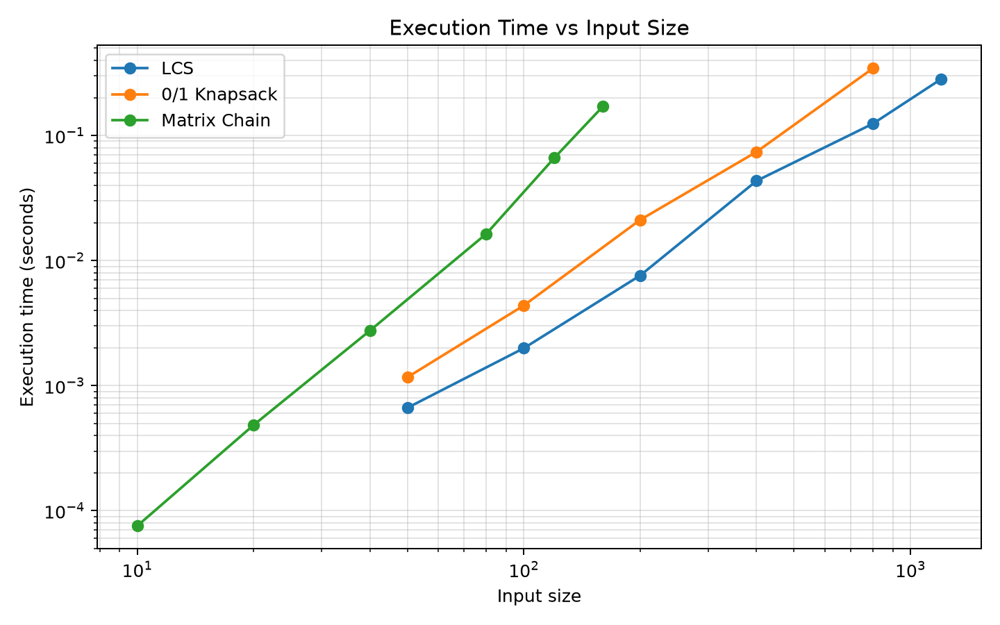
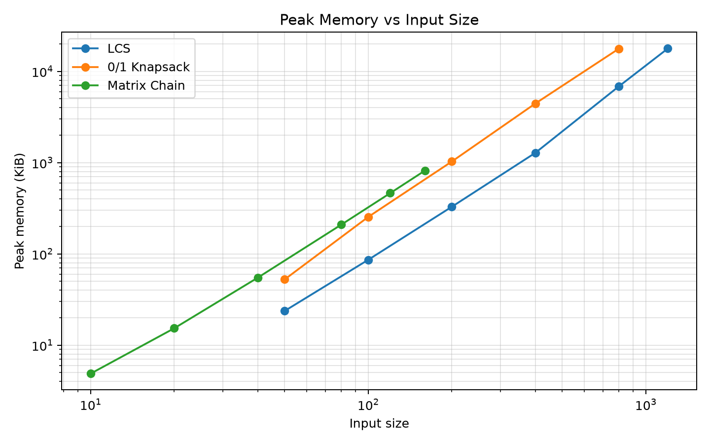
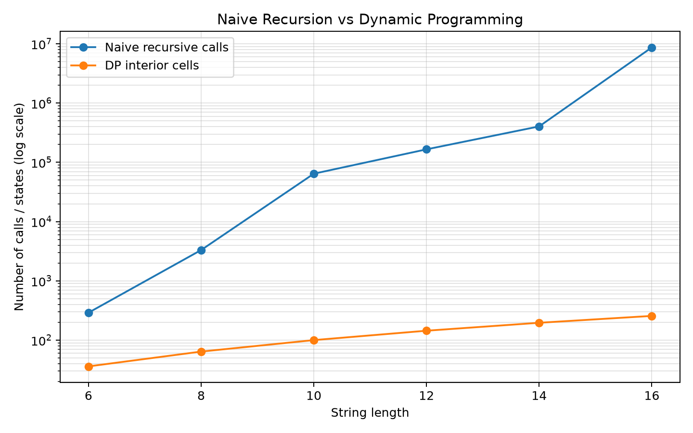
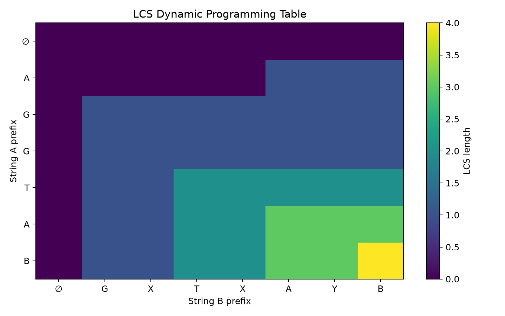
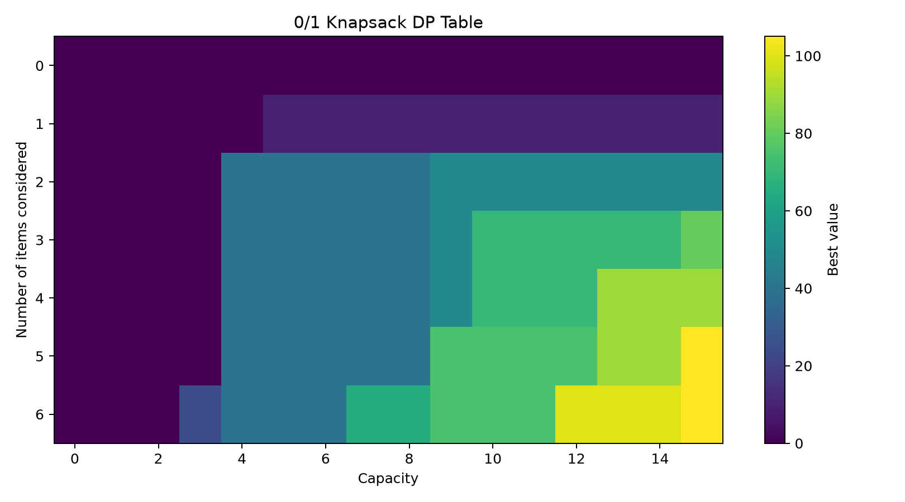
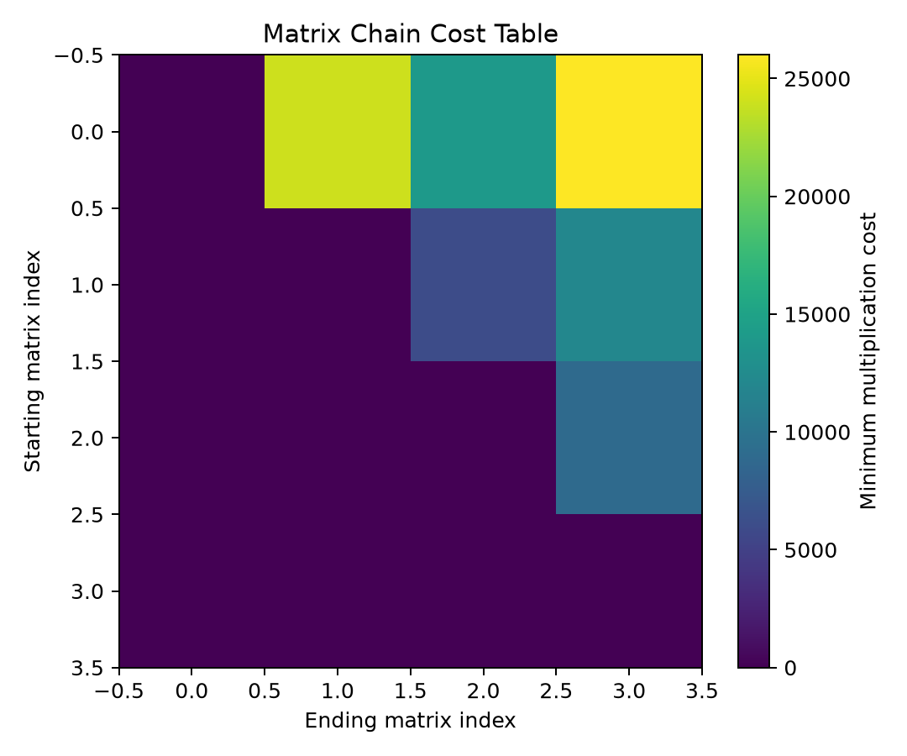

# DAA Lab 4: Dynamic Programming Algorithms

A Python-based implementation and performance analysis of three fundamental Dynamic Programming algorithms: Longest Common Subsequence (LCS), 0/1 Knapsack, and Matrix Chain Multiplication.

The project demonstrates algorithm implementation, DP table generation, solution reconstruction, execution-time measurement, memory analysis, and graphical visualization.

## Project Overview

**Course:** Design and Analysis of Algorithms (DAA)  
**Lab:** Lab 4 – Dynamic Programming  
**Student:** Harshit Kumar  
**Programme:** BCA (AI & Data Science)

## Algorithms Implemented

### 1. Longest Common Subsequence (LCS)
- Finds the longest common subsequence between two strings.
- Uses Dynamic Programming with a 2D table.
- Reconstructs one optimal subsequence.
- Compares naive recursion with DP.

**Time Complexity:** O(m × n)  
**Space Complexity:** O(m × n)

### 2. 0/1 Knapsack Problem
- Maximizes total item value within a given capacity.
- Uses a DP table to calculate optimal values.
- Identifies selected items.
- Includes one-dimensional space optimization.

**Time Complexity:** O(n × W)  
**Space Complexity:** O(n × W)  
**Optimized Space:** O(W)

### 3. Matrix Chain Multiplication
- Finds the optimal parenthesization of matrices.
- Minimizes the total number of scalar multiplications.
- Generates cost and split tables.

**Time Complexity:** O(n³)  
**Space Complexity:** O(n²)

## Technologies Used

- Python
- NumPy
- Pandas
- Matplotlib
- Tracemalloc
- CSV
- Dynamic Programming

## Project Structure

```text
DAA-Lab-4-Dynamic-Programming/
│
├── app.py
├── lcs.py
├── knapsack_dp.py
├── matrix_chain.py
├── run_experiments.py
├── make_plots.py
├── requirements.txt
├── README.md
│
└── outputs/
    ├── benchmark_results.csv
    ├── recursive_vs_dp.csv
    ├── runtime_comparison.png
    ├── memory_comparison.png
    ├── recursion_vs_dp.png
    ├── lcs_dp_table.png
    ├── knapsack_dp_table.png
    └── matrix_chain_dp_table.png
```

## Installation and Execution

Clone the repository:

```bash
git clone YOUR_REPOSITORY_URL
cd DAA-Lab-4-Dynamic-Programming
```

Install dependencies:

```bash
python -m pip install -r requirements.txt
```

Run individual algorithms:

```bash
python lcs.py
python knapsack_dp.py
python matrix_chain.py
```

Run the interactive application:

```bash
python app.py
```

Run performance experiments:

```bash
python run_experiments.py
```

Generate visualizations:

```bash
python make_plots.py
```

## Performance Analysis

The algorithms were tested with different input sizes to measure execution time, peak memory consumption, and the number of DP states.

### Execution Time Comparison



### Memory Usage Comparison



### Naive Recursion vs Dynamic Programming



## DP Table Visualizations

### Longest Common Subsequence



### 0/1 Knapsack



### Matrix Chain Multiplication



## Experimental Results

The following results were obtained by executing the project locally.

### LCS Benchmark

| Input Size | Execution Time (s) | Memory (KiB) |
|---:|---:|---:|
| 50 | 0.000666 | 23.73 |
| 100 | 0.001994 | 86.28 |
| 200 | 0.007611 | 328.66 |
| 400 | 0.043489 | 1282.34 |
| 800 | 0.124581 | 6867.66 |
| 1200 | 0.282825 | 17813.09 |

### 0/1 Knapsack Benchmark

| Input Size | Execution Time (s) | Memory (KiB) |
|---:|---:|---:|
| 50 | 0.001169 | 52.57 |
| 100 | 0.004381 | 254.45 |
| 200 | 0.021193 | 1028.88 |
| 400 | 0.074176 | 4451.68 |
| 800 | 0.345293 | 17762.74 |

### Matrix Chain Benchmark

| Input Size | Execution Time (s) | Memory (KiB) |
|---:|---:|---:|
| 10 | 0.000076 | 4.88 |
| 20 | 0.000484 | 15.32 |
| 40 | 0.002759 | 54.95 |
| 80 | 0.016399 | 209.51 |
| 120 | 0.066487 | 463.82 |
| 160 | 0.170645 | 818.26 |

## Sample Outputs

| Algorithm | Result |
|---|---|
| LCS | Length = 4, Subsequence = GTAB |
| 0/1 Knapsack | Maximum Value = 105 |
| Matrix Chain | Minimum Cost = 26000 |

### Recursion vs DP Observation

For LCS with string length 16:

- Recursive Calls: 8,701,076
- Recursive Execution Time: 1.696248 seconds
- DP Execution Time: 0.000077 seconds
- DP Interior Cells: 256

This experiment demonstrates how Dynamic Programming reduces repeated computations by storing previously calculated results.

## Conclusion

This project demonstrates the practical implementation of Dynamic Programming through three classical optimization problems.

The experiments show how DP improves computational efficiency by avoiding repeated calculations and storing intermediate results. Performance graphs and experimental measurements provide a practical understanding of execution time, memory consumption, and algorithm scalability.

## Author

**Harshit Kumar**  
BCA – Artificial Intelligence & Data Science

GitHub: [Harshit Kumar](https://github.com/Harshitkumar0018)
